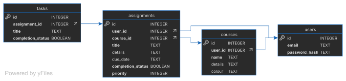

# Assignment Tracker

[Video Demo](https://youtu.be/_1i7epJogAA)

## Technologies used

- [Python](https://www.python.org/)
- [Flask](https://flask.palletsprojects.com/en/stable/)
- [HTML](https://html.spec.whatwg.org/multipage/)
- [Jinja](https://jinja.palletsprojects.com/en/stable/)
- [SQLite3](https://www.sqlite.org/)
- [cs50](https://cs50.readthedocs.io/libraries/cs50/python/)
- [Flask-Session](https://flask-session.readthedocs.io/en/latest/)
- [email_validator](https://gitlab.com/kalilinux/packages/python-email-validator)
- [werkzeug.security](https://werkzeug.palletsprojects.com/en/stable/utils/#module-werkzeug.security)

## Description

This is a web application developed as my final project for Harvard’s CS50x. It allows the user to create an account, with which they can then create, view, update, and delete courses, assignments for each course, and subtasks for each assignment.

### app.py

This file contains the base on which the flask server launches from. It deals with the main processing required for the application.

#### /

This is the default page that loads upon first opening the page. It just renders the index.html page

#### /home

This renders the home page if the user is logged in

#### /login

This clears the current session before processing the login request

If posted, this route logs the user in if the details they enter are correct, or loads an apology if incorrect

If get, it loads the login.html page

#### /logout

This clears the session stored on the server, then redirects the user to the index page

#### /register

If posted, this route ensures that all of the information submitted is valid (passwords match, email entered is unique, etc), then hashes the password, and stores it within the database before sending them to the login screen. If anything isn't valid, an apology is loaded

If get, it renders the register.html page

#### /courses

If posted, this route performs any required verification, before either deleting a course, adding a new course, or editing a course. If any of the verification fails, then an apology is loaded.

If get, it renders the courses.html page, including any of the courses owned by the user

#### /add_course

This renders the add_course.html page, which is a form for creating courses.
If this route is posted, it means that the user has selected to edit a course, so the page displays this and auto-fills any relevant information currently stored about the course for the user to change.

#### /assignments

If get and id is not defined, then assignments.html is rendered, showing all of the assignments owned by the user, with any filters and sorting applied as chosen by the user

If id is defined, then it displays a more detailed view about a particular assignment through assignment.html

If this route is posted, then the data entered is verified before an assignment being added or edited, rendering an apology if something is wrong, before then redirecting to the detailed page about that assignment

#### /tasks

If posted, then verification is performed, before subtasks are added, deleted, or their completion status is changed, before redirecting to the assignment details page

If get, it redirects to /assignments

#### /add_assignment

Similar to /add_course, but with the assignments. Renders add_assignment.html, with any relevant data filled in if editing an assignment

### helpers.py

This file contains helper sub-processes for the main program, mainly those that can be run from different places in the main program, like the creation and rendering of error pages and checking if the user is logged in.

### planner.db

This is the database that stores all of the user data for the application. It contains 4 tables in which the data is stored: [assignments](#assignments), [courses](#courses), [tasks](#tasks), and [users](#users).

#### assignments

This table contains the relevant data for each assignment that is created by the user.
- id: Primary key used to uniquely identify and reference each assignment
- user_id: Foreign key used to ensure that the assignment is being edited or deleted by only the relevant user
- course_id: Foreign key used to identify which course each assignment is set to
- title: Set by the user to make the assignment more easily identifiable for them
- details: Stores the description of the assignment, as entered by the user
- due_date: Stored the date in which the assignment is due, as set by the user. Stored in YYYY-MM-DDTHH:MM format, as valid with the [ISO 8601 standard](https://www.iso.org/iso-8601-date-and-time-format.html)
- completion_status: Stores a boolean value to represent whether the assignment has been marked as complete (1) or not (0)
- priority: Stores an integer value to represent how important the assignment is to complete, from 1 (least important) to 3 (most important). This value is primarily used for sorting and filtering by the user

#### courses

This table is used to store the different courses to which a user can add an assignment. As a course is required in order to add an assignment, each user has a 'Default' course created when they first create an account, to which they can then add any assignments that they don't want to add to any particular course.
- id: Primary key used to uniquely identify and reference each course in the table
- user_id: Foreign key used to identify which user each course is owned by, and by extension which user can view, edit and delete each course and the assignments added to it
- name: String used to store the name of each course, as entered by the user
- details: String used to store details about each course, as entered by the user
- colour: string used to store a [colour as defined by Bootstrap](https://getbootstrap.com/docs/5.3/customize/color/) used to help it easier for the user to identify each course and the assignments associated with it, as decided by the user from a dropdown menu

#### tasks

Used to store the subtasks and relevant information for each assignment.
- id: Primary key used to uniquely identify and reference each task in the table
- assignment_id: Foreign key used to identify which assignment each task is part of
- title: String used as the name for each task. As this is the only free-writing option available to the user for this table, the user must choose something descriptive so they can understand what it means in the future
- completion_status: Stores a boolean value to represent whether the task has been marked as complete (1) or not (0)

#### users

Used to store the relevant data about each user in order for the application to be able to work, and work securely.
- id: Primary key used throughout the database in order to be able to uniquely identify each user and everything that belongs to them
- email: String used to store the email for each user. This is currently only used for login, so acts as the username, and must therefore be unique for each user
- password_hash: String used to stores the hashed password, including the salt generated by Werkzeug's password hashing functions. This allows passwords to be verified without storing the original password.

### requirements.txt

Contains a list of the python libraries that need to be installed in order for the application to function.
If any of these are not installed, then they can be installed using pip [library_name]. For more information, see the [pip documentation](https://pip.pypa.io/en/stable/).

### /templates

This folder contains the .html files that are used to render each page, as using jinja implemented through the flask.render_template() module

#### layout.html

This file contains the base (header and footer) used by all pages in the application to ensure consistency across all of the different pages. This is based upon the layout.html provided for [CS50's Finance PS](https://cs50.harvard.edu/x/psets/9/finance/).

#### Other html files

The other files in this folder contain the main body of the pages, following the HTML and Jinja formats. This can include, but is not limited to, forms, tables, page headings and bodies.

### /static

This folder contains the images and stylesheet used across the application.

## Reasoning

I chose to make this assignment tracker because as a student myself doing my A-Levels in May 2027, I understand the necessity for one place to be able to simply keep track of any assignments and any personal study goals. I understand there are already different applications that do this, however they are often a bit verbose, and either bombard you with adverts, require a hefty premium, or sell all your data. Because of that, I decided to develop my own using the skills I’ve learned over the past year of me slowly working my way through this course.

## How to run

### Self-Hosting
1. Download or clone this repository
2. In a terminal window, navigate to the folder containing the app.py
3. Ensure you have Python installed on your system by running `python -V`, which should print the python version you currently have installed. If either python is not installed, or your python version is older than `3.10`, then reference the [python documentation](https://www.python.org/) to find out how to install or update python on your machine
4. Ensure you have all the dependencies installed by running `pip install -r requirements.txt`
5. Run `flask run` in your terminal to start the server
6. Open the local address displayed in the terminal, which should be an IPv4 address followed by a port number, normally `http://127.0.0.1:5000`
7. Congratulate yourself on starting your own server

If you have any issues with any of this, contact me on the email visible on my [GitHub profile](https://github.com/WisePenguin63)

### External-hosting

At this time, there are no official versions of this application running on any servers. However, there may be in the future. At this point in time, your only option is [self hosting](#Self-Hosting)
